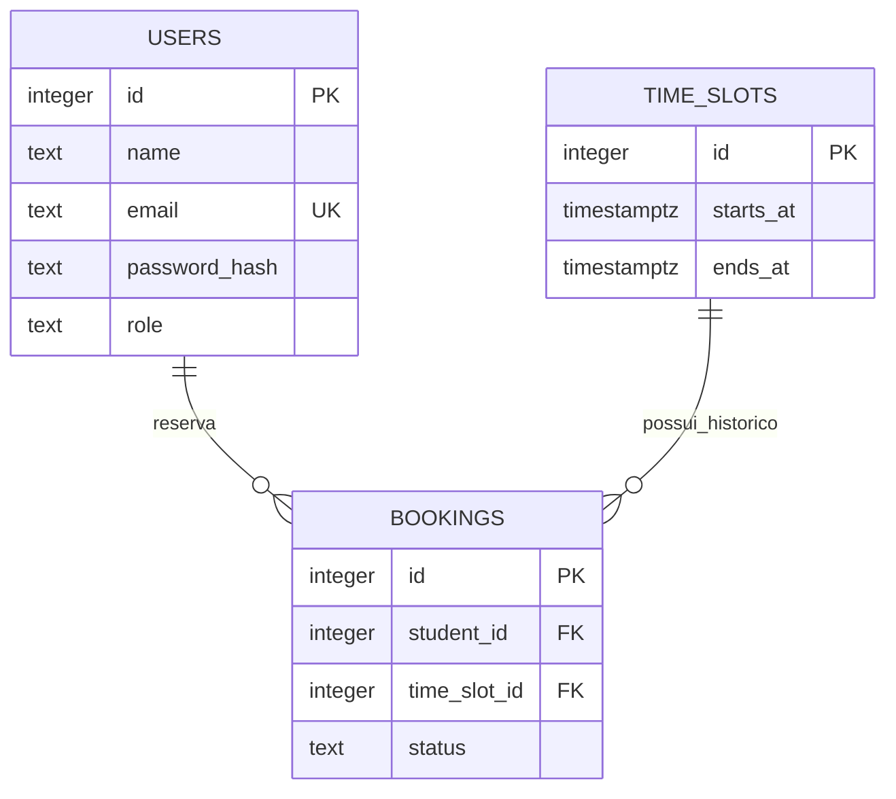

# Arquitetura e modelo de dados

[Voltar ao README](../README.md)

## Organização do projeto

```text
src/
  app.ts                 Configura Express, sessão, rotas e erros
  server.ts              Inicia a escuta na porta 3001
  database.ts            Configura o pool de conexões
  users/                 Cadastro, login, sessão e logout
  time-slots/            Horários e disponibilidade
  booking/               Reservas e cancelamento
  middleware/            Verificação de autenticação
  types/                 Campo userId da sessão
database/
  schema.sql             Estrutura completa para um banco novo
  migrations/            Alteração histórica do nome da tabela
tests/
  integration.cjs        Fluxos HTTP e garantias do PostgreSQL
docs/
  api.md                 Referência de endpoints e respostas
  arquitetura.md         Organização e modelo de dados
  banco.md               Schema e evolução do banco
  validacao-final.md      Cobertura da verificação e roteiro manual
  problemas-comuns.md     Diagnóstico de execução
```

Cada módulo contém `router.ts`, `controller.ts` e `service.ts`. O router escolhe a função; o controller lida com HTTP; o service aplica as regras e executa SQL. `app.ts` foi separado de `server.ts` para testar a aplicação em uma porta temporária sem iniciar o servidor normal.

## Modelo de dados



O índice parcial `bookings_one_confirmed_per_slot` permite vários registros cancelados no histórico, mas só uma reserva confirmada por horário. A restrição de exclusão `time_slots_no_overlap` impede intervalos sobrepostos. O intervalo é `[início, fim)`, portanto 14h–15h e 15h–16h podem coexistir.

## Identidade e propriedade

`users` representa contas, que podem ter papel `student` ou `teacher`. A sessão e `res.locals` usam `userId`. Já `bookings.student_id` e a propriedade JSON `studentId` identificam a conta que fez a reserva. Esse nome foi mantido para representar o papel da pessoa na reserva.

As permissões de professor ainda não estão conectadas às rotas. A autorização implementada restringe a consulta e o cancelamento de reservas à conta identificada pela sessão.

## Datas

O corpo HTTP usa strings ISO com fuso. O `pg` transforma `TIMESTAMPTZ` em objetos `Date`; o service usa `.getTime()` para compará-los ao instante atual. A serialização JSON devolve os horários em UTC.
